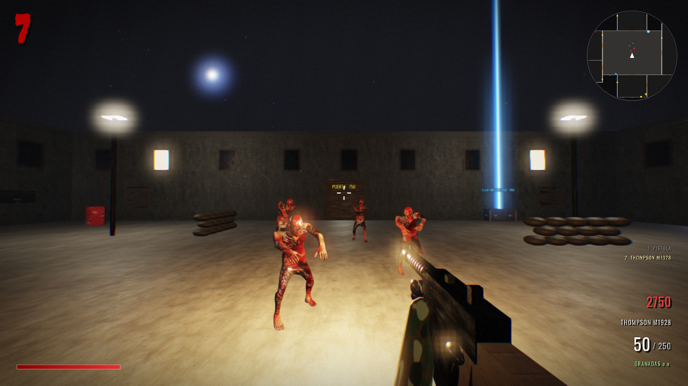
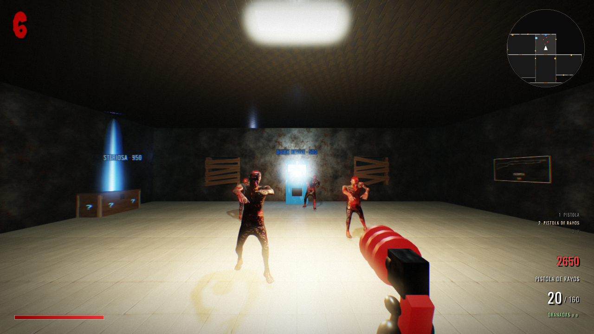
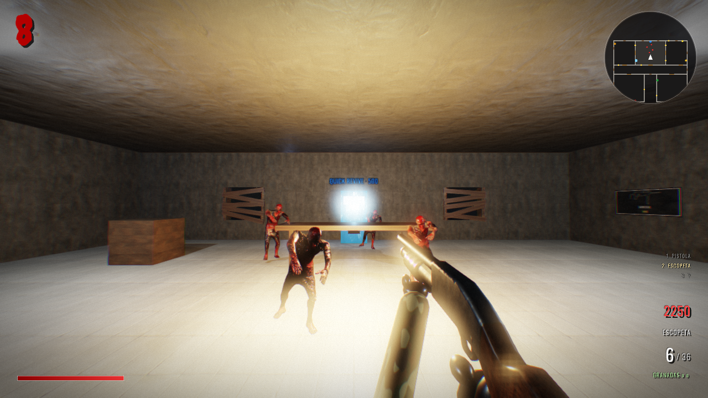
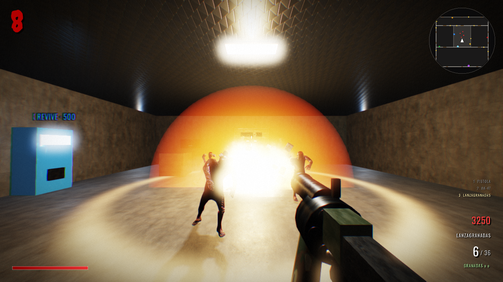

<div align="center">

# 🧟 ÚLTIMA RONDA

**Shooter de zombis por rondas en primera persona, inspirado en el modo Zombies clásico.**
Motor propio en **C++17 sobre raylib**: renderizado PBR, sombras dinámicas, HDR con bloom, ragdolls, cinemáticas y co-op en línea.


*Sobreviví todas las rondas que puedas. Cada ronda, más zombis. Cada ronda, más rápidos.*

### [⬇️ Descargar para Windows](https://github.com/FrankDesarrollo/ultima-ronda/releases/latest/download/UltimaRonda-Windows.zip)

</div>

---

## ⬇️ Descargar y jugar

1. Bajá **[UltimaRonda-Windows.zip](https://github.com/FrankDesarrollo/ultima-ronda/releases/latest/download/UltimaRonda-Windows.zip)** (≈110 MB) desde la sección [Releases](https://github.com/FrankDesarrollo/ultima-ronda/releases).
2. Descomprimilo en cualquier carpeta (clic derecho → *Extraer todo*).
3. Abrí `UltimaRonda.exe`. No hace falta instalar nada.
   - Si Windows muestra *"Windows protegió su PC"*, tocá **Más información → Ejecutar de todas formas** (aparece porque el juego no está firmado).

Requisitos: Windows 10 u 11 de 64 bits y una placa de video con OpenGL 3.3.

---

## 📸 Capturas

| Fuerte Reyes | Pueblo |
|:---:|:---:|
|  |  |
| **Laboratorio** | **Hospital** |
|  |  |
| **Caja misteriosa** | **Explosiones** |
|  |  |

## ✨ Características

- 📖 **Modo historia: *Operación Lázaro***. Seis capítulos con un compañero de escuadra, cinemáticas, diálogos con voz y un jefe final.
- 🗺️ **Seis mapas** más un campo de tiro:
  - **Búnker**: pasillos estrechos, 5 zonas.
  - **Fábrica**: mapa grande con 5 zonas.
  - **Pueblo**: al aire libre y de noche, con 7 zonas, cielo con luna, farolas, autos abandonados y zombis que salen de la tierra.
  - **Hospital San Rafael**: camillas, morgue y quirófano.
  - **Fuerte Reyes**: base militar con patio, hangar y camiones.
  - **Laboratorio**: instalación subterránea con cápsulas de criogenia.
  - **Campo de tiro**: todas las armas gratis para probarlas.
- 🔫 **21 armas**, de pistolas a lanzamisiles, incluidas las **armas maravilla** que solo salen en la caja (Pistola de rayos, Wunderwaffe DG-2 y Cañón de trueno), la ballesta explosiva, el lanzallamas y la ametralladora rotativa.
- 🎁 **Caja misteriosa** con su osito que la hace mudarse, y **Pack-a-Punch** para mejorar cualquier arma.
- 🖍️ **Armas de pared** dibujadas en tiza con la silueta real de cada arma.
- 🥤 **Bebidas** (Quick Revive, Juggernog, Speed Cola, Double Tap, Pola Veloz) y **corriente** que hay que activar para usarlas.
- 🧟 Zombis normales, **brutos**, **explosivos** y **rondas de perros del infierno**. Arrancan las tablas de las ventanas para entrar, y se pueden reparar.
- 💥 **Power-ups**: Munición máxima, Muerte instantánea, Doble puntos y Bomba nuclear.
- 🤝 **Compañero bot**: te sigue, dispara, avisa de amenazas y se le puede reanimar. Disponible también en supervivencia.
- 🌐 **Co-op en línea para dos jugadores** (ver abajo).
- 🎬 **Cinemáticas**: llegada distinta a cada mapa y escenas de la historia con grúas, travellings, cámara lenta y subtítulos.
- 🦴 **Física**: ragdolls según el impacto, cajas y barriles que se empujan, y explosiones con onda expansiva, humo, escombros y fuego.
- 🧗 **Escalada**: el jugador puede subirse a cajas, autos, barriles y sacos de arena.
- 🥚 **Huevos de pascua** escondidos en cada mapa.
- 🏆 **Récords por mapa y opciones** (sensibilidad, volumen, FOV, calidad gráfica, FPS) que se guardan solos.

## 🎮 Controles

| Tecla | Acción | Tecla | Acción |
|---|---|---|---|
| `W A S D` | Moverse | `Ratón` | Apuntar |
| `Clic izq.` | Disparar | `Clic der.` | Mirilla |
| `Shift` | Correr | `Espacio` | Saltar |
| `C` | Agacharse (corriendo: deslizarse) | `V` | Cuchillo |
| `G` | Granada | `R` | Recargar |
| `E` | Comprar / abrir / reparar (mantener) | `1 2 3` / rueda | Cambiar arma |
| `M` | Música | `F3` | Gráficos rápidos |
| `F11` | Pantalla completa | `Esc` | Pausa y opciones |

## 📖 Modo historia: Operación Lázaro

*Hace tres días, el Búnker 7 dejó de responder.* Un sargento y su cabo entran a recuperar la investigación de la doctora **Elena Vidal** sobre el **Proyecto Lázaro**, un suero que devuelve la vida a los muertos. Lo que encuentran los pone en contra de su propio comandante, el **coronel Reyes**, y los lleva hasta el laboratorio donde espera el **Paciente Cero**.

| Capítulo | Mapa | Objetivos |
|---|---|---|
| **1 · Lo que quedó enterrado** | Búnker | Primera oleada, restaurar la corriente, recuperar 3 diarios grabados y resistir hasta la extracción |
| **2 · Línea de producción** | Fábrica | Colocar 3 cargas y escapar antes de que la fábrica explote |
| **3 · Pabellón 6** | Hospital | Fichas de pacientes, la tarjeta de la morgue y defender el quirófano mientras se suben los archivos |
| **4 · San Roque** | Pueblo | Encontrar a Vidal, reunir las muestras de la cura y aguantar hasta el amanecer |
| **5 · Órdenes** | Fuerte Reyes | Copiar los códigos de 3 terminales y resistir hasta que se abra el ascensor |
| **6 · Paciente Cero** | Laboratorio | Reunir los componentes de la cura, derrotar al jefe final y defender el sintetizador |

- **13 cinemáticas** con personajes animados, cortes de cámara, cámara en mano, grano de película y cámara lenta.
- **Más de 250 frases con voz** y subtítulos. El guion está en `cpp/assets/sfx/historia/guion.tsv`.
- Objetivo en pantalla, marcador con distancia, objetos en el minimapa y barra de progreso para las zonas a defender.
- El progreso se guarda solo y cada capítulo desbloquea el siguiente.

## 🌐 Multijugador (co-op en línea)

Dos jugadores por internet, P2P por IP pública: uno crea la partida (anfitrión) y el otro se une.

1. El **anfitrión** abre una vez el puerto **UDP 27015** en su router y acepta el aviso del firewall de Windows.
2. **Anfitrión**: `MULTIJUGADOR → CREAR PARTIDA →` elige el mapa. El juego muestra su IP pública.
3. **Invitado**: `MULTIJUGADOR → UNIRSE →` escribe esa IP (o `Ctrl+V`) `→ CONECTAR`.

- **Autoridad del anfitrión**: zombis, rondas, ventanas, power-ups y daño se resuelven en su PC, así nunca se desincronizan.
- **Movimiento sin retraso**: cada jugador simula su propio movimiento; la red ([ENet](http://enet.bespin.org), UDP) envía posiciones 30 veces por segundo y los eventos importantes por un canal confiable.
- **Compartido**: puertas, corriente, tablas de las ventanas y power-ups. **Individual**: puntos, armas, bebidas y Pack-a-Punch.
- **Reanimación**: si un jugador cae, el otro tiene 30 s para levantarlo.
- Si el proveedor usa CGNAT y no se puede abrir el puerto, funciona igual con Radmin VPN o ZeroTier.

## 🛠️ Compilar

El juego compila con un **g++ portátil (w64devkit)** y **raylib 5.5**, que no se incluyen en el repositorio por su tamaño.

1. Descargá [w64devkit](https://github.com/skeeto/w64devkit/releases) y extraelo en `cpp/tools/w64devkit/`.
2. Descargá el código de [raylib 5.5](https://github.com/raysan5/raylib/releases/tag/5.5), extraelo en `cpp/tools/raylib-5.5/` y compilá la librería (`make` dentro de `src/`).
3. Ejecutá:

```bat
cd cpp
build.bat
```

El ejecutable queda en `cpp/UltimaRonda/UltimaRonda.exe`. Copiá la carpeta `cpp/assets` al lado del `.exe` para jugar.

> **Requisitos:** Windows 10/11 y una gráfica compatible con OpenGL 3.3.

### Pruebas automáticas

El ejecutable incluye modos sin ventana que juegan solos y guardan capturas y registros, por ejemplo:

```bat
UltimaRonda.exe --test bunker salida      :: partida completa en un mapa
UltimaRonda.exe --story 1 salida          :: un capítulo de la historia
UltimaRonda.exe --armas salida            :: todas las armas y efectos
UltimaRonda.exe --capturas salida         :: las capturas de este README
```

## 📁 Estructura

```
cpp/
├── src/
│   ├── main.cpp        → bucle principal, jugador, rondas, power-ups y modos de prueba
│   ├── world.cpp       → mapas, colisiones, puertas, ventanas, caja misteriosa, Pack-a-Punch
│   ├── weapons.cpp     → armas, disparo, proyectiles, explosiones y efectos
│   ├── zombie.cpp      → comportamiento y animación de zombis, perros y jefe final
│   ├── render.cpp      → PBR, sombras, HDR + bloom y posprocesado
│   ├── story.cpp       → modo historia: capítulos, objetivos y diálogos
│   ├── cutscene.cpp    → cinemáticas definidas como datos
│   ├── intro.cpp       → cinemática de llegada a cada mapa
│   ├── ally.cpp        → compañero bot
│   ├── net.cpp         → lógica del co-op (anfitrión con autoridad)
│   ├── netlow.cpp      → capa de red sobre ENet
│   ├── ragdoll.cpp     → ragdolls con Verlet
│   ├── anim.cpp        → animaciones esqueléticas desde glTF
│   ├── hud.cpp, audio.cpp, voice.cpp, options.cpp, eggs.cpp
│   └── game.h          → tipos y estado compartido
├── assets/     → modelos, texturas, sonidos, voces, música y fuentes
├── test/       → herramientas de preparación de assets
├── third_party/→ ENet
└── build.bat   → script de compilación
```

El prototipo original del juego, hecho con **Three.js**, está en la raíz (`index.html`, `game.js`, `style.css`): se abre directo en el navegador.

## 🙏 Créditos

Todos los recursos externos son libres (CC0 u OFL):

- **Zombi y animaciones**: "Male City Zombie" de Rikindle3D (OpenGameArt)
- **Perro del infierno**: "Wolf" de Quaternius (poly.pizza)
- **Soldados**: "Character Soldier" de Quaternius (poly.pizza)
- **Árboles**: "Trees" y "Dead Trees" de Quaternius (poly.pizza)
- **Camuflaje**: "Camouflage 8" de [ShareTextures](https://sharetextures.com); **cuero de los guantes**: Leather037 de ambientCG
- **Texturas**: [ambientCG](https://ambientcg.com)
- **Armas y granada**: "Guns & Explosives" de 3DModelsCC0
- **Sonidos**: The Free Firearm Sound Library, SpringySpringo, zer0_sol, artisticdude, Darsycho y pauliuw (OpenGameArt)
- **Música**: "Insistent" de yd y "Abandoned passages" de congusbongus (OpenGameArt)
- **Fuentes**: Oswald y Creepster (Google Fonts, SIL OFL)
- **Motor**: [raylib](https://www.raylib.com) (zlib)
- **Red**: [ENet](http://enet.bespin.org) de Lee Salzman (MIT)
