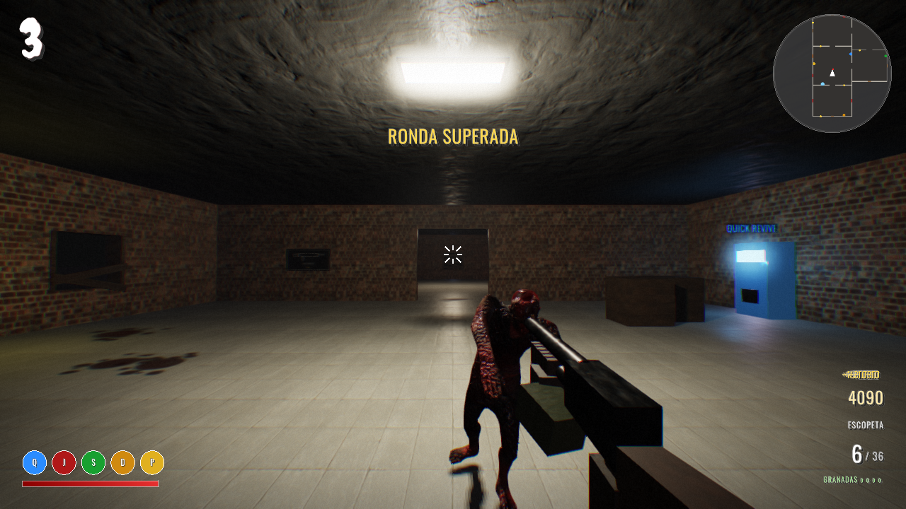
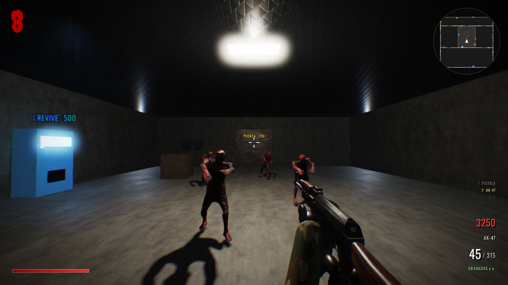
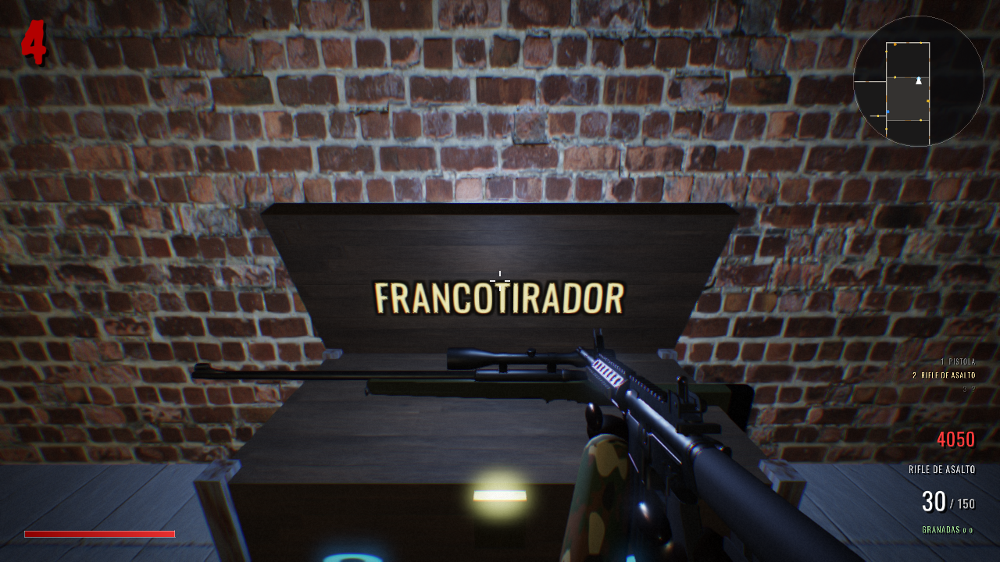
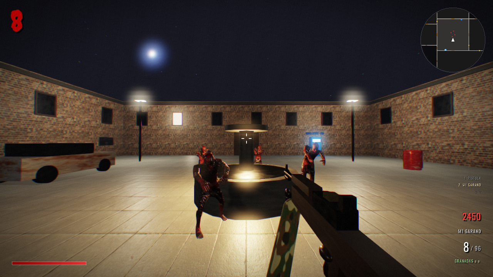

<div align="center">

# 🧟 ÚLTIMA RONDA

**Shooter de zombis por rondas en primera persona, inspirado en el modo Zombies clásico.**
Hecho desde cero en **C++ con raylib**: renderizado PBR, sombras, ragdolls y audio propio.




*Sobreviví todas las rondas que puedas. Cada ronda, más zombis. Cada ronda, más rápidos.*

</div>

---

## 📸 Capturas

| Fábrica | Caja misteriosa |
|:---:|:---:|
|  |  |

<p align="center"><br><em>Pueblo: el mapa al aire libre</em></p>

## ✨ Características

- 📖 **Modo historia: *Operación Lázaro***. Seis capítulos con Milton como compañero, cinemáticas, diálogos con voz y un jefe final (ver abajo).
- 🤝 **Compañero bot**: el cabo Milton pelea a tu lado en la historia, y en supervivencia si lo activás en Opciones. Sus bajas también te dan puntos, y si te acercás y presionás `E` te da charla.
- 🪖 **Uniformes**: Frank con camuflaje de bosque, Milton de desierto y los soldados de Reyes de negro, con casco y piel propios. Mueven la cabeza y asienten cuando hablan.
- 🥚 **Huevos de pascua** (ver abajo).
- 🗺️ **Seis mapas**: **Búnker** (pasillos estrechos) y **Fábrica** (mapa grande), con 5 zonas cada uno, y **Pueblo**, un mapa grande **al aire libre** de noche con 7 zonas: plaza, calle principal, iglesia, cementerio, estación, casa y taller, con cielo con luna y estrellas, farolas, autos abandonados y zombis que salen de la tierra. Nuevos: **Hospital** San Rafael (camillas, morgue y quirófano), **Fuerte Reyes** (base militar con patio al aire libre, hangar y camiones) y **Laboratorio** bajo tierra (cápsulas de criogenia y el núcleo). Además, un **Campo de tiro** para probar todas las armas gratis.
- 🧗 **Te podés subir** a cajas, barriles, autos, lápidas, sacos de arena y a la caja misteriosa: saltá contra ellos y trepás solo.
- 🗣️ **El personaje habla**: insulta a los zombis cuando lo hieren y comenta las bajas, los tiros a la cabeza, las recargas, las rondas nuevas y los perros.
- 🎬 **Cinemática de llegada** en cada mapa, con un soldado hablando por radio y subtítulos. Cada mapa entra distinto: corriendo a una ventana (Búnker), avanzando despacio con el arma lista (Hospital, Fábrica), espalda con espalda (Laboratorio) o con una grúa que baja desde el cielo (Pueblo, Fuerte Reyes). Después la cámara recorre la sala y baja hasta tus ojos (se salta con `Espacio`).
- 🔫 **21 armas**, de pistolas a lanzamisiles, incluidas las **armas maravilla** que solo salen en la caja: Pistola de rayos, Wunderwaffe DG-2 (rayos en cadena) y Cañón de trueno. Nuevas: **Thompson** con tambor, **M1 Garand** (con su "¡ping!"), **ballesta explosiva** (la flecha se clava, pita y revienta), **lanzallamas** y **ametralladora rotativa** (gira los cañones antes de disparar).
- 💥 **Explosiones de verdad**: bola de fuego que se vuelve humo negro, polvo que corre por el suelo, chispas, escombros que rebotan (algunos encendidos), onda expansiva y luz que parpadea.
- 🖍️ **Armas de pared** dibujadas en tiza con la **forma real** de cada arma; cuando la comprás, queda colgada sobre su dibujo.
- 🎁 **Caja misteriosa** (950) con signos "?" que brillan, su haz de luz azul, el nombre del arma real que sale y su **osito de peluche** que la hace mudarse, y **Pack-a-Punch** (5000) para mejorar cualquier arma con nombre nuevo.
- 🥤 **Bebidas**: Quick Revive, Juggernog, Speed Cola, Double Tap y Pola Veloz.
- ⚡ **Interruptor de la corriente**: sin él, casi todas las bebidas y el Pack-a-Punch están apagados.
- 🐺 **Rondas de perros del infierno** con niebla y rayos.
- 🧟 Zombis normales, **brutos** y **explosivos**, que arrancan las tablas de las ventanas para entrar (mantené **E** para repararlas).
- 💥 **Power-ups**: Munición máxima, Muerte instantánea, Doble puntos y Bomba nuclear.
- 🦴 **Física**: los zombis caen como muñecos de trapo según dónde y con qué les das, y las cajas y barriles se pueden empujar.
- 🏆 **Récords** por mapa y **opciones** (sensibilidad, volumen, FOV, gráficos rápidos, FPS) que se guardan solas.

## 🎮 Controles

| Tecla | Acción | Tecla | Acción |
|---|---|---|---|
| `W A S D` | Moverse | `Ratón` | Apuntar |
| `Clic izq.` | Disparar | `Clic der.` | Mirilla |
| `Shift` | Correr | `Espacio` | Saltar |
| `C` | Agacharse (corriendo: deslizarse) | `V` | Cuchillo |
| `G` | Granada | `R` | Recargar |
| `E` | Comprar / abrir / reparar (mantener) | `1 2 3` / rueda | Cambiar arma |
| `M` | Música | `F3` | Gráficos rápidos |
| `F11` | Pantalla completa | `Esc` | Pausa y opciones |

## 📖 Modo historia: Operación Lázaro

*Hace tres días, el Búnker 7 dejó de responder.* El sargento **Frank** y el cabo **Milton** entran a recuperar la investigación de la doctora **Elena Vidal** sobre el **Proyecto Lázaro**, un suero que devuelve la vida a los muertos. Lo que encuentran los pone en contra de su propio comandante, el **coronel Reyes**, y los lleva hasta el laboratorio donde espera el **Paciente Cero**.

| Capítulo | Mapa | Lo que pasa |
|---|---|---|
| **1 · Lo que quedó enterrado** | Búnker | Primera oleada, corriente, los 3 diarios grabados de Vidal y 90 s hasta la extracción |
| **2 · Línea de producción** | Fábrica | Reyes ordena volar la fábrica. 3 cargas (mantener `E`), Vidal aparece en la radio y la fábrica explota (cinemática) |
| **3 · Pabellón 6** | Hospital | Corriente, fichas de los pacientes, la tarjeta de la morgue y **defender el quirófano** mientras se suben los archivos |
| **4 · San Roque** | Pueblo | Encuentran a Vidal en la iglesia, juntan las muestras de la cura y aguantan hasta el amanecer… cuando muerden a Milton |
| **5 · Órdenes** | Fuerte Reyes | Copiar los códigos de 3 terminales, el discurso de Reyes por los altavoces y resistir hasta que se abra el ascensor |
| **6 · Paciente Cero** | Laboratorio | Los componentes de la cura, **el jefe final Lázaro** (con barra de vida) y defender el sintetizador. Final y epílogo |

- 🤝 **Milton pelea a tu lado** (bot): te sigue por las puertas, dispara a los zombis que ve, avisa si tenés uno detrás y habla durante la partida. Si cae, lo levantás manteniendo `E` (o se levanta solo a los 40 s). También se puede activar en supervivencia desde **Opciones**.
- 🎬 **13 cinemáticas** con actores (Frank, Milton y zombis): una charla entre Frank y Milton al empezar cada capítulo y 7 escenas de la historia, además de la llegada a cada mapa. Montadas como en el cine: grúas, travellings, órbitas, planos a ras del piso, cortes secos, cámara en mano, grano de película, **cámara lenta** (el salto de la fábrica, la mordida) y efecto vértigo cuando despierta Lázaro. Los personajes corren, caminan, se agachan, saltan, empujan y saludan, y el que escucha gira la cabeza hacia el que habla; en los diálogos la cámara pasa a primeros planos por encima del hombro.
- 🎙️ **Más de 250 frases con voz**: Frank, Milton, el coronel Reyes por radio y por altavoces, Vidal en vivo y en sus grabaciones. El guion completo está en `cpp/assets/sfx/historia/guion.tsv`.
- 🧭 Objetivo en pantalla, marcador con la distancia, objetos en el minimapa y barra para las zonas a defender.
- 💾 El progreso se guarda solo (`historia.txt`): cada capítulo desbloquea el siguiente. Si caés, reintentás el capítulo.

## 🥚 Huevos de pascua

<details>
<summary>Spoilers</summary>

- 🧸 **Tres ositos escondidos en cada mapa.** Encontrá los tres en una partida y te llevás la Pistola de Rayos mejorada con Pack-a-Punch… y Milton estrena uniforme rosa (se puede apagar en Opciones).
- 📻 **Una radio vieja con la luz verde en cada mapa.** Cada una guarda una grabación del pasado. Con las seis se escucha la verdad sobre Lázaro.
- 🗣️ **Escribí `CABEZON`** durante la partida o en la pausa: zombis cabezones (y más fáciles de acertar a la cabeza).
- 💬 Algunas charlas de Milton tienen pistas.

</details>

## 🌐 Multijugador (co-op en línea)

Dos jugadores por internet, P2P por IP pública: **Frank** crea la partida y **Milton** se une.

1. **Frank** abre una vez el puerto **UDP 27015** en su router (reenvío de puertos hacia su PC) y acepta el aviso del firewall de Windows.
2. **Frank**: `MULTIJUGADOR → CREAR PARTIDA →` elige el mapa. El juego muestra su IP pública.
3. **Milton**: `MULTIJUGADOR → UNIRSE →` escribe esa IP (o `Ctrl+V`) `→ CONECTAR`.

- 🧠 **El anfitrión manda**: zombis, rondas, ventanas, power-ups y daño se calculan en la PC de Frank, así nunca se desincronizan.
- ⚡ **Sin retraso al moverse**: cada uno mueve a su soldado en su PC; la red (UDP con [ENet](http://enet.bespin.org)) manda posiciones 30 veces por segundo y los eventos importantes por un canal confiable.
- 🤝 **Compartido**: puertas, corriente, tablas de las ventanas y power-ups. **De cada uno**: puntos, armas, bebidas y Pack-a-Punch.
- 🩹 **Caer y levantarse**: si caés, tu compañero tiene 30 s para levantarte manteniendo `E`.
- Si el proveedor usa CGNAT y el puerto no se puede abrir, sirve igual con Radmin VPN o ZeroTier.

## 🛠️ Compilar

El juego compila con un **g++ portátil (w64devkit)** y **raylib 5.5**, que no están en el repo por su tamaño.

1. Descargá [w64devkit](https://github.com/skeeto/w64devkit/releases) y extraelo en `cpp/tools/w64devkit/`.
2. Descargá el código de [raylib 5.5](https://github.com/raysan5/raylib/releases/tag/5.5), extraelo en `cpp/tools/raylib-5.5/` y compilá la librería (`make` dentro de `src/`).
3. Ejecutá:

```bat
cd cpp
build.bat
```

El ejecutable queda en `cpp/UltimaRonda/UltimaRonda.exe`. Copiá la carpeta `cpp/assets` al lado del `.exe` para jugar.

> **Requisitos:** Windows 10/11 y una gráfica con OpenGL 3.3.

### Prototipo web

La primera versión del juego (*Noche de Zombis*) está hecha con **Three.js**: abrí `index.html` en el navegador y listo.

## 📁 Estructura

```
├── index.html, game.js, style.css   → prototipo web (Three.js)
├── CLAUDE.md          → guía del proyecto para la IA (reglas, arquitectura, recetas)
├── CONTEXTO.md        → mapa del código generado solo (archivos, funciones con línea, mapas, armas)
├── scripts/contexto.js → genera CONTEXTO.md
├── .githooks/         → pre-commit que mantiene CONTEXTO.md al día
└── cpp/
    ├── src/
    │   ├── main.cpp        → bucle principal, jugador, rondas, power-ups y modos de prueba
    │   ├── world.cpp       → mapas, puertas, ventanas, caja misteriosa, Pack-a-Punch, corriente
    │   ├── weapons.cpp     → armas, disparo, proyectiles, explosiones y efectos
    │   ├── zombie.cpp      → zombis, perros, jefe final y soldados animados
    │   ├── render.cpp      → PBR, sombras, HDR + bloom
    │   ├── story.cpp       → modo historia (capítulos, objetivos, radio)
    │   ├── cutscene.cpp    → cinemáticas con actores
    │   ├── intro.cpp       → cinemática de llegada a cada mapa
    │   ├── ally.cpp        → Milton, el compañero bot
    │   ├── eggs.cpp        → huevos de pascua
    │   ├── net.cpp, netlow.cpp → co-op en línea (ENet)
    │   └── hud.cpp, audio.cpp, voice.cpp, options.cpp, ragdoll.cpp, anim.cpp, game.h
    ├── assets/     → modelos, texturas, sonidos, voces de la historia, música y fuentes
    ├── test/       → herramientas de prueba y preparación de assets
    └── build.bat   → script de compilación
```

## 🤖 Programar con IA

El repo trae contexto listo para que Claude Code (u otra IA) arranque sin leer archivo por archivo:

- **`CLAUDE.md`**: se carga solo al abrir Claude Code en la carpeta. Tiene las reglas (idioma, estilo, qué archivos no abrir), la arquitectura y recetas para agregar armas, mapas o frases.
- **`CONTEXTO.md`**: lo genera `node scripts/contexto.js` leyendo el código: qué hace cada archivo, todas las funciones con su número de línea, mapas, armas, cinemáticas, modos de prueba y assets.
- **Se actualiza solo**: Claude Code lo regenera después de cada edición (hook en `.claude/settings.json`) y git lo regenera en cada commit (`.githooks/pre-commit`). Después de clonar, activá el hook una vez:

```sh
git config core.hooksPath .githooks
```

Necesita [Node.js](https://nodejs.org). Para revisar si está al día: `node scripts/contexto.js --check`.

## 🙏 Créditos

Todos los recursos externos son libres (CC0 u OFL):

- **Zombi y animaciones**: "Male City Zombie" de Rikindle3D (OpenGameArt)
- **Perro del infierno**: "Wolf" de Quaternius (poly.pizza)
- **Frank (soldado de la cinemática)**: "Character Soldier" de Quaternius (poly.pizza)
- **Árboles**: "Trees" y "Dead Trees" de Quaternius (poly.pizza)
- **Camuflaje de las mangas**: "Camouflage 8" de [ShareTextures](https://sharetextures.com); **cuero de los guantes**: Leather037 de ambientCG
- **Texturas**: [ambientCG](https://ambientcg.com)
- **Armas y granada**: "Guns & Explosives" de 3DModelsCC0
- **Sonidos**: The Free Firearm Sound Library, SpringySpringo, zer0_sol, artisticdude, Darsycho y pauliuw (OpenGameArt)
- **Música**: "Insistent" de yd y "Abandoned passages" de congusbongus (OpenGameArt)
- **Fuentes**: Oswald y Creepster (Google Fonts, SIL OFL)
- **Motor**: [raylib](https://www.raylib.com) (zlib)
- **Red del co-op**: [ENet](http://enet.bespin.org) de Lee Salzman (MIT)

---

<div align="center">

Hecho con 🩸 por **madebyfrank**

</div>
